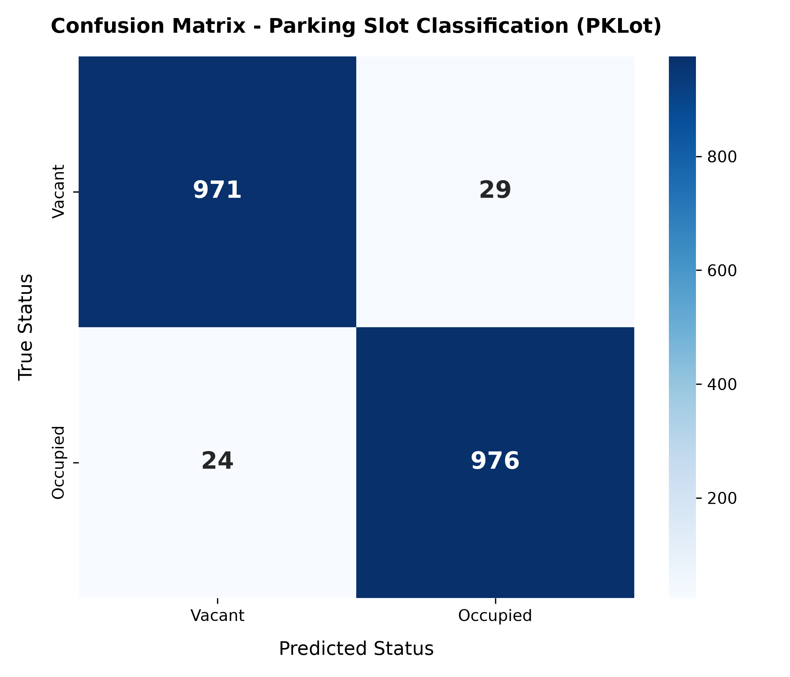

# AI-Based Parking Slot Occupancy Classification
**Capstone Project 21: Computer Vision + Smart Transportation**

An end-to-end Computer Vision system that classifies parking spaces as **Occupied** or **Vacant** using camera footage in real-time. Built with PyTorch, OpenCV, and Streamlit, benchmarked on the 12,416-image **PKLot dataset**.



---

## 🚀 Key Highlights & Capabilities
- **Real-Time Visual Classification**: Deep Convolutional Neural Network (CNN) performing sub-2ms per-slot inference.
- **Smart Color Coded Bounding Boxes**: Instantly renders **Green (Vacant)** and **Red (Occupied)** boxes on parking lot feeds.
- **Live Occupancy Dashboard**: Real-time counters showing Total Slots, Available Slots, Occupied Slots, and dynamic Occupancy Rate (%).
- **Multi-Weather Generalization**: Tested and benchmarked across Sunny, Cloudy, and Rainy surveillance camera scenarios.
- **Comprehensive Evaluation**: Full calculation of Accuracy, Precision, Recall, F1-Score, and Confusion Matrix.
- **Interactive Calibration Tool**: Easily define and calibrate slot coordinates for any new camera view.

---

## 📁 Repository Structure
```
d:\VAC\AI PRK LOT\
├── data/
│   ├── PRL LOT/                 # Raw PKLot YOLO dataset (train, valid, test)
│   ├── patches/                 # Cropped 64x64 slot patches (12,000 images)
│   └── slots_config.json        # Predefined slot bounding coordinates (ROI)
├── models/
│   ├── cnn_classifier.py        # ParkingSlotCNN & MobileNetV2 PyTorch models
│   └── best_parking_model.pth   # Best trained checkpoint weights
├── src/
│   ├── prepare_dataset.py       # Crops & balances empty/occupied slot patches
│   ├── dataset_loader.py        # PyTorch transforms, augmentations & DataLoaders
│   ├── train.py                 # Training script with validation & curve plotting
│   ├── evaluate.py              # Test set evaluation (Precision, Recall, F1, Confusion Matrix)
│   └── parking_detector.py      # Core inference engine & visual overlay HUD
├── sample_data/                 # Sample parking lot camera test scenes
├── output/
│   ├── confusion_matrix.png     # Heatmap visualization
│   ├── training_curves.png      # Loss and accuracy curves
│   ├── evaluation_metrics.json  # Exported metrics
│   └── AI_Parking_Occupancy_Capstone_Presentation.pptx # Generated PPT presentation
├── report/
│   └── Capstone_Project_Report.md # Full academic/technical capstone report
├── app.py                       # Streamlit interactive Web Dashboard
├── generate_presentation.py     # Script to generate presentation PPT
└── requirements.txt             # Required Python packages
```

---

## 🛠️ Quick Start Guide

### 1. Install Dependencies
```bash
pip install -r requirements.txt
```

### 2. Prepare & Extract Dataset Patches
```bash
python src/prepare_dataset.py
```
*Extracts 12,000 balanced parking slot patches into `data/patches/` and saves `slots_config.json`.*

### 3. Train the Deep Learning Model
```bash
python src/train.py --model custom_cnn --epochs 10 --batch_size 64 --lr 0.001
```
*Saves the highest validation accuracy weights to `models/best_parking_model.pth` and saves learning curves.*

### 4. Evaluate on Independent Test Set
```bash
python src/evaluate.py
```
*Computes Accuracy, Precision, Recall, F1-Score and generates `confusion_matrix.png`.*

### 5. Launch the Streamlit Web Dashboard
```bash
streamlit run app.py
```
*Opens `http://localhost:8501` with the interactive live detection and monitoring dashboard.*

### 6. Generate PowerPoint Presentation
```bash
python generate_presentation.py
```
*Generates `output/AI_Parking_Occupancy_Capstone_Presentation.pptx` ready for capstone submission.*

---

## 📊 Dataset & Citation
This project utilizes the **PKLot Dataset**:
```bibtex
@article{almeida2015pklot,
  title={PKLot -- A robust dataset for parking lot classification},
  author={Almeida, Paulo R and Oliveira, Luiz S and Silva Jr, Edson and Britto Jr, Alceu S and Koerich, Alessandro L},
  journal={Expert Systems with Applications},
  volume={42},
  number={11},
  pages={4937--4949},
  year={2015},
  publisher={Elsevier}
}
```
Licensed under **Creative Commons Attribution 4.0 (CC BY 4.0)**.
